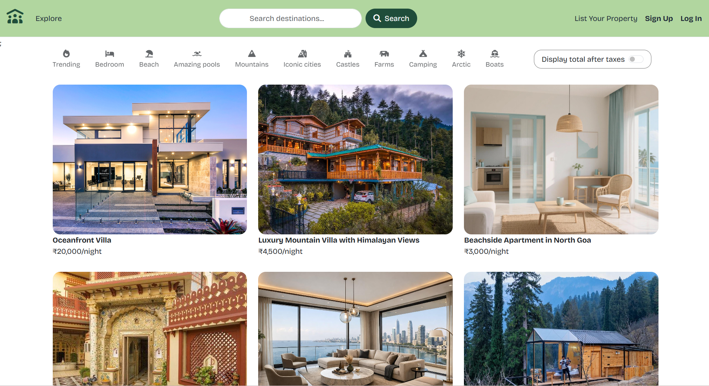
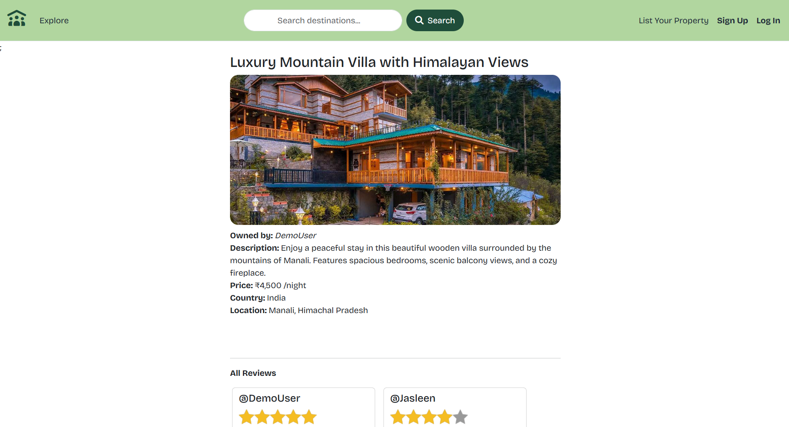
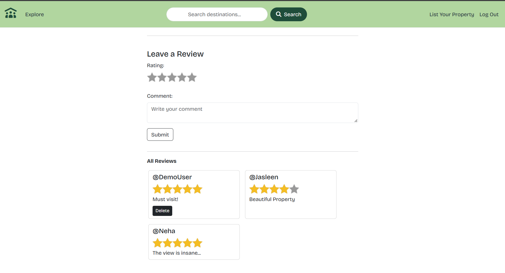
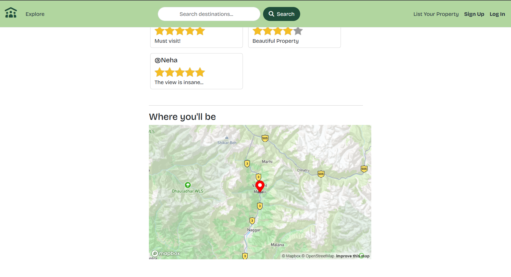
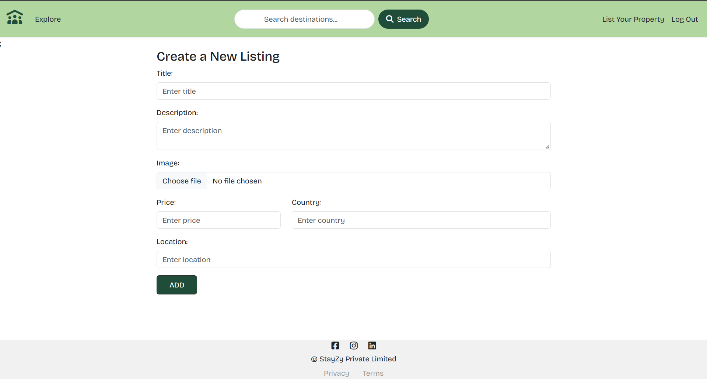

# StayZy🏡

StayZy is a full-stack vacation-rental listing web application where users can discover places to stay, create and manage property listings, view locations on an interactive map, and share reviews.

## Demo

https://stayzy-vklf.onrender.com/listings

### Demo Credentials

- **Username:** DemoUser
- **Password:** DemoUser

You can also create a new account using the Sign Up option.

## Screenshots

**Home Page**



**Listing Details**





**Create a Listing**


<br>

## ✨ Features

- 🔐**User Authentication:** Secure signup, login, and logout using Passport.js.
- 🏡**Listing Management:** Create, view, edit, and delete property listings.
- 🖼️**Image Uploads:** Upload and store property images using Cloudinary.
- 🗺️**Interactive Maps:** Display property locations using Mapbox.
- ⭐**Reviews and Ratings:** Allow users to leave reviews with 1–5 star ratings.
- 🛡️**Authorization:** Restrict listing modifications to owners and review deletion to review authors.
- ✅**Data Validation:** Validate listing data using Joi and display feedback through flash messages.

<br>

## 💻 Tech Stack

- **Backend:** Node.js, Express.js
- **Database:** MongoDB, Mongoose
- **Frontend:** EJS, ejs-mate, Bootstrap, CSS
- **Authentication:** Passport.js, Passport-Local-Mongoose
- **Session Management:** express-session, connect-mongo
- **Image Storage:** Cloudinary, Multer
- **Maps & Geocoding:** Mapbox
- **Validation:** Joi

<br>

## 🏗️ Application Architecture

StayZy follows the **MVC (Model-View-Controller) architecture** to organize application logic and separate responsibilities.

- **Models:** Define MongoDB schemas for users, listings, and reviews using Mongoose.
- **Views:** Render dynamic web pages using EJS and ejs-mate.
- **Controllers:** Handle application logic for listings, reviews, and user authentication.
- **Routes:** Define endpoints and connect incoming requests to the appropriate controllers.
- **Middleware:** Handle authentication, authorization, data validation, session management, and error handling.

<br>

## 🚀 Getting Started

Follow these steps to run StayZy on your local machine.

### 📋 Prerequisites

- Node.js and npm
- MongoDB connection string
- Cloudinary account
- Mapbox access token

<br>
### 1️⃣ Clone the Repository

```bash
git clone https://github.com/jjasleen01/Stayzy-FullStack.git
cd Stayzy-FullStack
```

### 2️⃣ Install Dependencies

```bash
npm install
```

### 3️⃣ Configure Environment Variables

Create a `.env` file in the project root and add:

```env
ATLASDB_URL=your_mongodb_connection_string
SECRET=your_session_secret
CLOUD_NAME=your_cloudinary_cloud_name
CLOUD_API_KEY=your_cloudinary_api_key
CLOUD_API_SECRET=your_cloudinary_api_secret
MAP_TOKEN=your_mapbox_access_token
```

Replace the placeholder values with your own credentials. Never commit your `.env` file or expose your API secrets.

### 4️⃣ Start the Application

```bash
node app.js
```

Open your browser and visit:

http://localhost:8080/listings

<br>

## 🔮 Future Improvements

- 🔍 **Search & Filters:** Search listings by location and filter by price.
- 📅 **Booking System:** Add a booking feature with an availability calendar.
- ❤️ **Wishlist:** Allow users to save their favorite properties.
- ⭐ **Review Management:** Allow users to edit their existing reviews.

<br>

## Author

**Jasleen**

- GitHub: [@jjasleen01](https://github.com/jjasleen01)
